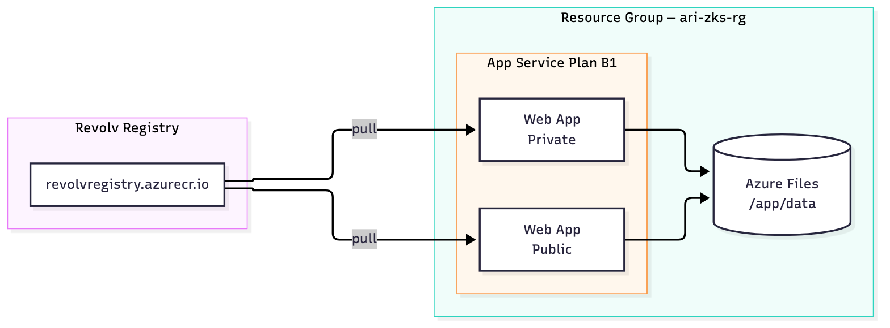
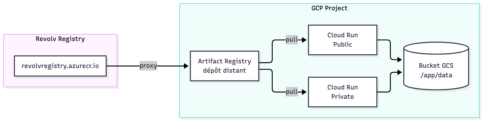
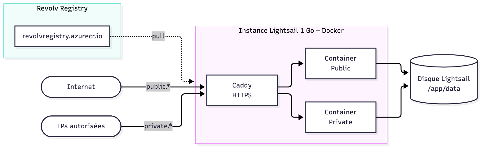
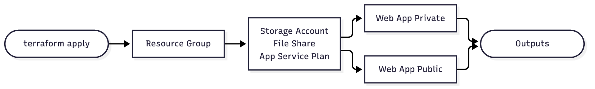
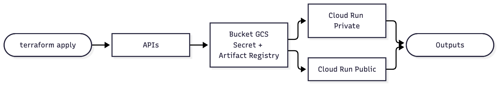
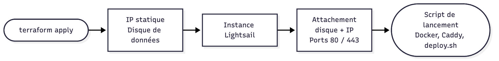

# ARI-ZKS — Déploiement Dual Web Apps

Déploie deux instances de l'application (instance `private` et instance `public`) depuis un container registry, avec un volume de stockage partagé entre les deux. Supporte Azure, GCP et AWS.

## Structure

```
terraform/
  azure/    — Azure App Service + Azure Files
  gcp/      — GCP Cloud Run + GCS Bucket
  aws/      — AWS Lightsail (Docker + Caddy HTTPS) + disque Lightsail
scripts/
  deploy-azure-dual-instances.sh   — déploiement Azure via Azure CLI
```

---

## Architecture

### Comparaison des clouds

Chaque cloud utilise un modèle d'hébergement différent : le contrat applicatif est identique (image, variables d'environnement, port `8000`, volume `/app/data`), mais le comportement en production ne l'est pas.

| | Azure | GCP | AWS |
|---|---|---|---|
| Hébergement | App Service (PaaS) | Cloud Run (serverless, scale-to-zero) | 1 instance Lightsail + Docker |
| Volume partagé | Azure Files (SMB) | Bucket GCS (gcsfuse) | Disque Lightsail local |
| HTTPS | Natif (`*.azurewebsites.net`) | Natif (`*.run.app`) | Caddy + Let's Encrypt (`*.sslip.io` ou domaine) |
| Accès à l'instance Private | **Ouvert à tous** | Authentification IAM Google | Liste d'IP (`private_allowed_cidrs`) ou tunnel SSH |
| Pull de l'image | Direct (credentials) | Via dépôt distant Artifact Registry | Direct (`docker login`) |
| Redéploiement | `az webapp restart` | Nouvelle révision Cloud Run | `deploy.sh` via SSH |
| Haute disponibilité | Gérée par Azure | Gérée par Google | Non (instance unique) |
| Coût / mois | ~\$14 | ~\$0.20 | ~\$8 |

> Voir [Limitations connues](#limitations-connues) pour les écarts qui impactent la sécurité et la fiabilité.

### Azure



### GCP



### AWS



### Flux de déploiement Terraform

#### Azure



#### GCP



#### AWS



---

## Estimation des coûts

> Tarifs indicatifs région **West Europe / europe-west1 / eu-west-1**, mars 2026. Hors trafic réseau sortant.

### Résumé

| | Azure | GCP | AWS |
|---|---|---|---|
| **Mois** | ~\$14 | ~\$0.20 | ~\$8 |
| **An** | ~\$163 | ~\$2.40 | ~\$94 |

> GCP est quasi-gratuit grâce au scale-to-zero de Cloud Run et au bucket GCS facturé à la consommation réelle.

### Détail Azure

| Ressource | SKU | Coût/mois |
|---|---|---|
| App Service Plan (2 apps) | B1 Linux | \$13.14 |
| Azure Files | Standard LRS, 5 Go | \$0.30 |
| Storage Account (opérations) | — | ~\$0.01 |
| **Total** | | **~\$13.45 / mois — ~\$161 / an** |

> L'App Service Plan B1 tourne en continu même sans trafic — c'est le coût fixe incompressible d'Azure App Service.

### Détail GCP

| Ressource | SKU | Coût/mois |
|---|---|---|
| Cloud Run (2 services) | Scale-to-zero, free tier 2M req/mois | ~\$0 |
| GCS Bucket | Standard, 5 Go | ~\$0.10 |
| Secret Manager | 1 secret (mot de passe registry) | \$0.06 |
| Artifact Registry | Dépôt distant, cache de l'image (0.5 Go gratuits) | ~\$0.05 |
| **Total** | | **~\$0.20 / mois — ~\$2.40 / an** |

> Cloud Run scale à 0 quand il n'y a pas de trafic — aucun compute facturé au repos. Le free tier couvre 2 millions de requêtes/mois, 360 000 vCPU-secondes et 180 000 Go-secondes, suffisant pour un usage modéré.

### Détail AWS

| Ressource | SKU | Coût/mois |
|---|---|---|
| Instance Lightsail | `micro_3_0` (2 vCPU, 1 Go, 40 Go SSD, 2 To de trafic inclus) | \$7.00 |
| IP statique | Incluse tant qu'elle est attachée | \$0 |
| Disque de données | 8 Go | \$0.80 |
| **Total** | | **~\$8 / mois — ~\$94 / an** |

> Prix fixe : une seule instance Lightsail héberge les deux containers et Caddy (reverse proxy HTTPS, certificats Let's Encrypt gratuits), sans Load Balancer. `nano_3_0` (512 Mo) descend à ~\$6/mois si la mémoire suffit. Pas de haute disponibilité : si l'instance tombe, le service est coupé jusqu'au redémarrage (les données restent sur le disque Lightsail).

---

## Ressources créées

### Azure

| Ressource | Nom | Description |
|---|---|---|
| Resource Group | `ari-zks-rg` | Conteneur logique Azure |
| Storage Account | `arizks{hex8}storage` | Stockage Azure Files |
| File Share | `shared-data` | Volume partagé (5 Go) monté sur `/app/data` |
| App Service Plan | `ari-zks-{hex8}-plan` | Plan Linux B1 hébergeant les deux apps |
| Web App Private | `private-ari-zks-{hex8}` | Instance avec `ALLOW_PRIVATE_ACCESS=true` |
| Web App Public | `public-ari-zks-{hex8}` | Instance avec `ALLOW_PRIVATE_ACCESS=false` |

### GCP

| Ressource | Nom | Description |
|---|---|---|
| GCS Bucket | `ari-zks-{hex8}-data` | Volume partagé, monté sur `/app/data` |
| Secret | `ari-zks-{hex8}-registry-password` | Mot de passe du registry Revolv (Secret Manager) |
| Artifact Registry | `ari-zks-{hex8}-revolv` | Dépôt distant (proxy) vers le registry Revolv, utilisé par Cloud Run |
| Cloud Run Private | `private-ari-zks-{hex8}` | Instance avec `ALLOW_PRIVATE_ACCESS=true`, scale-to-zero |
| Cloud Run Public | `public-ari-zks-{hex8}` | Instance avec `ALLOW_PRIVATE_ACCESS=false`, accès `allUsers`, scale-to-zero |

### AWS

| Ressource | Nom | Description |
|---|---|---|
| Instance Lightsail | `ari-zks-{hex8}` | Amazon Linux 2023 + Docker : containers `private`, `public` et `caddy` |
| IP statique | `ari-zks-{hex8}` | IP fixe, base des hostnames `public.<ip>.sslip.io` / `private.<ip>.sslip.io` |
| Disque Lightsail | `ari-zks-{hex8}-data` | Données persistantes (SQLite + certificats), monté sur `/app/data` |
| Ports publics | — | 80/443 ouverts ; SSH limité au SSH navigateur de la console et à `ssh_allowed_cidrs` |
| Clé SSH (optionnelle) | `ari-zks-{hex8}` | Créée si `ssh_public_key` est renseignée |

### Variables d'environnement injectées (communs)

| Variable | Valeur | Description |
|---|---|---|
| `ENV` | `azure` / `gcp` / `aws` | Environnement d'exécution |
| `INSTANCE_ID` | `private` / `public` | Identifiant de l'instance |
| `ALLOW_PRIVATE_ACCESS` | `true` / `false` | Contrôle d'accès privé |
| `ENCRYPTION_KEY` | secret | Clé de chiffrement (auto-générée) |
| `REVOLV_SHARED_SECRET` | secret | Secret partagé Revolv (auto-généré) |
| `DATABASE_URL` | `sqlite:////app/data/data.db` | Base de données SQLite sur le volume partagé |

---

## Déploiement

### Azure — Terraform

#### Prérequis
- [Terraform](https://developer.hashicorp.com/terraform/install) >= 1.0
- [Azure CLI](https://learn.microsoft.com/fr-fr/cli/azure/install-azure-cli) connecté (`az login`)

```bash
cd terraform/azure/

cp terraform.tfvars.example terraform.tfvars
# Éditer terraform.tfvars

terraform init
terraform plan
terraform apply
```

#### Variables

| Variable | Requis | Défaut | Description |
|---|---|---|---|
| `container_image` | Oui | — | Image complète (ex: `registry.io/ari-zks:latest`) |
| `registry_username` | Oui | — | Utilisateur du registry |
| `registry_password` | Oui | — | Mot de passe du registry |
| `resource_group_name` | Non | `ari-zks-rg` | Nom du Resource Group |
| `location` | Non | `westeurope` | Région Azure |
| `encryption_key` | Non | auto-généré | Clé de chiffrement |
| `revolv_shared_secret` | Non | auto-généré | Secret partagé Revolv |

---

### GCP — Terraform

#### Prérequis
- [Terraform](https://developer.hashicorp.com/terraform/install) >= 1.0
- [gcloud CLI](https://cloud.google.com/sdk/docs/install) connecté (`gcloud auth application-default login`)
- Un projet GCP existant avec la facturation activée


```bash
cd terraform/gcp/

cp terraform.tfvars.example terraform.tfvars
# Éditer terraform.tfvars

terraform init
terraform plan
terraform apply
```

#### Variables

| Variable | Requis | Défaut | Description |
|---|---|---|---|
| `project_id` | Oui | — | ID du projet GCP |
| `container_image` | Oui | — | Image complète (ex: `registry.io/ari-zks:latest`) |
| `registry_username` | Oui | — | Utilisateur du registry |
| `registry_password` | Oui | — | Mot de passe du registry |
| `region` | Non | `europe-west1` | Région GCP |
| `encryption_key` | Non | auto-généré | Clé de chiffrement |
| `revolv_shared_secret` | Non | auto-généré | Secret partagé Revolv |

---

### AWS — Terraform

#### Prérequis
- [Terraform](https://developer.hashicorp.com/terraform/install) >= 1.0
- [AWS CLI](https://docs.aws.amazon.com/cli/latest/userguide/getting-started-install.html) configuré (`aws configure` ou `aws sso login`)

```bash
cd terraform/aws/

cp terraform.tfvars.example terraform.tfvars
# Éditer terraform.tfvars

terraform init
terraform plan
terraform apply
```

#### Variables

| Variable | Requis | Défaut | Description |
|---|---|---|---|
| `container_image` | Oui | — | Image complète (ex: `registry.io/ari-zks:latest`) |
| `registry_username` | Oui | — | Utilisateur du registry |
| `registry_password` | Oui | — | Mot de passe du registry |
| `region` | Non | `eu-west-1` | Région AWS |
| `bundle_id` | Non | `micro_3_0` | Plan Lightsail : `nano_3_0` (0.5 Go, \$5), `micro_3_0` (1 Go, \$7), `small_3_0` (2 Go, \$12) |
| `data_disk_size` | Non | `8` | Taille du disque de données (Go, minimum 8) |
| `domain` | Non | `<ip>.sslip.io` | Domaine (`public.<domain>`, `private.<domain>`), avec un DNS wildcard vers `public_ip` |
| `private_allowed_cidrs` | Non | `[]` | CIDRs autorisés sur l'instance Private (vide = tunnel SSH uniquement) |
| `ssh_public_key` | Non | — | Clé publique SSH (`ec2-user`), sinon clé par défaut Lightsail de la région |
| `ssh_allowed_cidrs` | Non | `[]` | CIDRs autorisés en SSH, en plus du SSH navigateur de la console |
| `encryption_key` | Non | auto-généré | Clé de chiffrement |
| `revolv_shared_secret` | Non | auto-généré | Secret partagé Revolv |

> Toute modification Terraform de l'instance la recrée ; les données restent sur le disque Lightsail. Pour une nouvelle version de l'image, pas besoin de Terraform : `ssh ec2-user@<ip> sudo /opt/ari-zks/deploy.sh <image>` (voir `terraform output useful_commands`).
>
> Les secrets (credentials registry, clés applicatives) sont transmis via le script de lancement de l'instance et stockés sur l'instance dans `/opt/ari-zks/config/` (root uniquement).

---

### Azure — Script shell

```bash
# Avec credentials en paramètres
./scripts/deploy-azure-dual-instances.sh revolvregistry.azurecr.io/ari-zks:latest myuser mypassword

# Sans credentials (demandés interactivement)
./scripts/deploy-azure-dual-instances.sh revolvregistry.azurecr.io/ari-zks:latest
```

Variables d'environnement optionnelles : `APP_NAME`, `RESOURCE_GROUP`, `LOCATION`, `ENCRYPTION_KEY`, `REVOLV_SHARED_SECRET`.

---

## Récupérer les secrets et outputs

```bash
# Nom auto-généré
terraform output app_name

# Secrets
terraform output -raw encryption_key
terraform output -raw revolv_shared_secret
```

---

## Commandes utiles post-déploiement

### Azure
```bash
az webapp log tail --name private-ari-zks-{hex8} --resource-group ari-zks-rg
az webapp restart  --name public-ari-zks-{hex8}  --resource-group ari-zks-rg
```

### GCP
```bash
gcloud run services logs read private-ari-zks-{hex8} --region europe-west1
gcloud run services update  public-ari-zks-{hex8}  --region europe-west1
```

### AWS
```bash
# Logs (ou SSH navigateur de la console Lightsail)
ssh ec2-user@<ip> sudo docker logs -f public

# Redéployer (re-pull de l'image)
ssh ec2-user@<ip> sudo /opt/ari-zks/deploy.sh

# Changer d'image
ssh ec2-user@<ip> sudo /opt/ari-zks/deploy.sh <registry>/ari-zks:<tag>
```

---

## Limitations connues

- **Accès à l'instance Private non homogène** : sur Azure, la Web App Private est exposée publiquement sans restriction réseau ; sur GCP, elle exige un token IAM Google (inutilisable depuis un navigateur sans proxy) ; sur AWS, elle est restreinte par IP. La protection repose donc, selon le cloud, uniquement sur l'application (`ALLOW_PRIVATE_ACCESS`).
- **SQLite sur stockage réseau (Azure, GCP)** : les deux instances écrivent dans la même base via Azure Files (SMB) ou gcsfuse, qui gèrent mal (Azure) ou pas du tout (GCS) le verrouillage de fichiers SQLite. Risque de corruption en cas d'écritures concurrentes.
- **Cloud Run sans limite d'instances (GCP)** : chaque service peut monter à plusieurs containers, multipliant les écrivains SQLite concurrents.
- **Instance unique (AWS)** : pas de haute disponibilité ; une panne de l'instance coupe le service jusqu'à son redémarrage (les données restent sur le disque Lightsail).
- **sslip.io (AWS)** : sans `domain`, les hostnames dépendent d'un service DNS tiers et des limites de Let's Encrypt. Utiliser un domaine client en production.

---

## Notes

- Les diagrammes sont générés depuis les sources `docs/diagrams/*.mmd` :
  ```bash
  cd docs/diagrams
  for f in *.mmd; do
    npx -y @mermaid-js/mermaid-cli -i "$f" -o "${f%.mmd}.png" -s 2 -b white
  done
  ```

- L'image container doit être disponible dans le registry Revolv avant le déploiement.
- Le nom de l'application (`ari-zks-{hex8}`) est **toujours auto-généré** pour garantir l'unicité des ressources.
- Les deux instances partagent la même base de données SQLite via le volume partagé (`/app/data/data.db`).
- Le fichier `terraform.tfvars` est ignoré par git. Ne jamais le committer.
